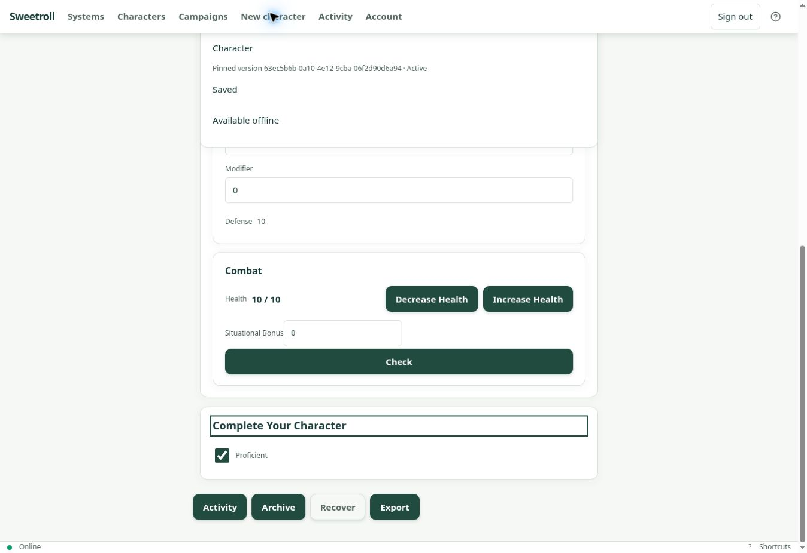

# Character creation investigation — 2026-11-05

Target: <https://sweetroll-d2-preview.up.railway.app> (isolated preview).
Application: `7a5c5112269dbfcb22fc5de28cd90cc551eef892`.
Successful Railway deployment: `c27fb7d1-6137-485a-84d1-077ed630793e`.
The service source/deployment was checked before the browser journey.

## Finding

After acceptance sign-in, New character had no available system versions.
Both existing D20 System entries were unpublished drafts. Opening each showed
“Draft (unpublished)” and “Not published yet”. The picker correctly requires a
published version. No application-code failure was reproduced in this flow.

## Verification

A separate d20 clone was named **D20 Character Creation Test** and published as
**0.1.0**. The two original drafts were preserved.

| Browser action | Observed result |
| --- | --- |
| Publish the test copy | Version 0.1.0 became live. |
| Follow Create test character | System metadata and entity selector loaded. |
| Create Character Creation Verification | Character sheet opened and reported Saved. |
| Edit Ancestry and Proficient | Human and the checked proficiency persisted. |
| Run Check | Roll result 3 was displayed. |
| Open normal New character menu | D20 Character Creation Test 0.1.0 appeared in the picker. |
| Reopen the character | Saved edits remained and the sheet was available offline. |

Published version: `63ec5b6b-0a10-4e12-9cba-06f2d90d6a94`.
Character: <https://sweetroll-d2-preview.up.railway.app/characters/2cf37b1b-6065-44e9-be3c-d55e3d8bca70>.
These test fixtures remain available for the owner. No application code or
production configuration was changed for this investigation.

To use an existing draft: open the system, select Publish, confirm publication,
then use Create test character or the New character menu.

This browser journey used acceptance authentication; it does not close real
provider-login, physical-device, human visual approval or table-playtest gates.
