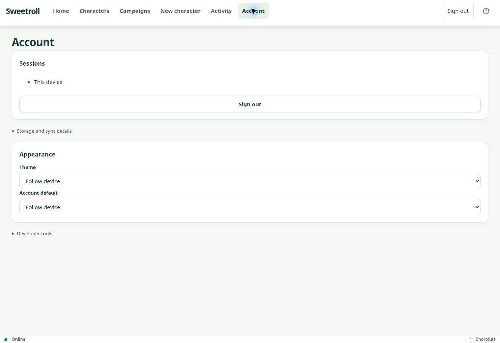
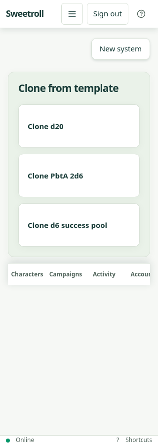
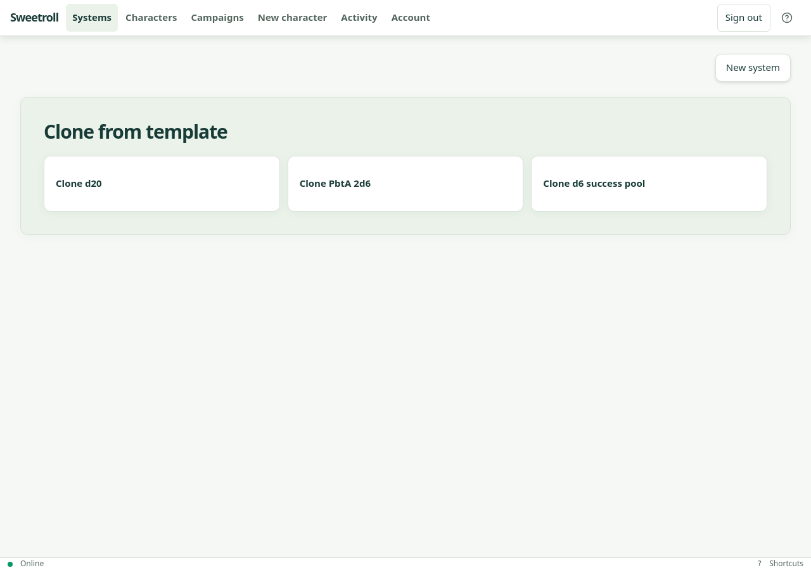

# GUI progressive disclosure — 2026-11-05

Implementation: PR #33, `feat/gui-progressive-disclosure`.
Application under test: `45aea0b3c9f9f80e116273af4a91b150c3a1bc0d`.

## Delivered behavior

Normal mode hides internal identifiers, revisions, checksums, diagnostic codes
and expression ASTs. Account → Developer tools → Show debug information reveals
these on the current device. Debug changes presentation, not permissions.
Identifier editing, validation limits, appearance, token coordinates and roll
calculations remain available in disclosures. Names, values, roll outcomes,
errors, publication blockers, permissions and conflict actions remain visible.
Creator actions and save state are consolidated, and appearance settings live
in Account. Member selectors use names, with identity suffixes when needed.

## Verification

| Check | Observed result |
| --- | --- |
| Red–green component tests | New disclosure/debug/name/diagnostic assertions failed before implementation and passed after it. |
| Frontend unit suite | 1,227 passed in 125 files. |
| Backend unit suite | 488 passed, 10 skipped. |
| Type checking and frontend production build | Passed. |
| Existing local browser journeys | 61/62 passed together; remaining setup journey passed after adapting its member-row selector to readable names. |
| New normal/debug journeys | Both 360px and 1280px passed; defaults, navigation persistence, identifier editing and preserved field values verified. |
| CI integration, contracts and Docker | Recorded in the PR checks; final workflow is authoritative. |
| Offline production-worker regressions | Recorded in the PR checks; final workflow is authoritative. |
| Focused production-worker rerun | All three campaign template/derived-template journeys passed after selectors were updated for the normal-mode “Campaign item” label. |
| Full multi-user production-worker rerun | MU-00–MU-12 passed with one GM and three players, 24 rolls, named preview/sharing, offline recovery and scoped cleanup. |
| Visual snapshots | Nine changed screenshots from CI run 42039280192, artifact 13420491381, inspected by the agent and proposed as updated baselines. Unchanged 360px sheet-preview baseline retained. |

The nine CI screenshots cover creator, library, publish dialog, conflict banner
and desktop sheet preview. No overlaps or clipped primary actions were observed.
Local rendering has different font metrics, so local screenshots were not used
as baseline replacements. Human visual sign-off remains open.

## Hosted preview

Isolated preview: <https://sweetroll-d2-preview.up.railway.app>.
Source: `Kajonn/sweetroll`, branch `feat/gui-progressive-disclosure`.
Deployment `e8109f95-33f3-4878-a5e0-da820c464afc` successfully deployed application
`45aea0b`. Production sources were not changed.

An earlier deployment of the same increment (`e3d4bc5`) was exercised manually:
cloned the d20 fixture, checked normal Account and creator presentation, enabled
debug, checked user/revision/sheet/section/element identifiers, navigated back,
and disabled debug. Values and navigation were preserved. Debug was left off.
The final application additionally passed the automated debug journeys above.

Local browser checks use real Chromium and PostgreSQL 17; temporary configs
outside the repository replace the restricted tsx CLI IPC launcher with
`node --import tsx` and bind to loopback. No application behavior was mocked.

Physical-device, real-provider-login, human visual approval and table/remote
playtest gates remain open. These checks do not close the complete G9 release gate.

## Follow-up: Systems and compact navigation

The requested follow-up renames Home to Systems on the existing `/` system
library route. The normal header is now 57px tall in browser checks, with a
navigation disclosure below 1024px and inline links on desktop. Creator and
campaign tabs stay in one horizontally scrollable row with 44px targets.
Phone bottom navigation, sign-out, shortcut help and native link URLs remain.

Red–green component tests verify the Systems label, client navigation, menu
closing and Escape focus restoration. All 1,230 frontend unit tests passed;
type checking and the production build passed. Eleven existing/follow-up browser
checks passed together, followed by five focused checks covering 320/360/768/1280px,
menu bounds, 200% text, Systems return navigation and campaign tab keyboard
scrolling. Full branch CI results and the exact updated deployment are recorded
in PR #33. Screenshot baselines are reviewed separately in the CI environment.

The agent inspected the Systems and campaign layouts at phone and desktop
widths. This provides browser evidence, not human visual or physical-device
acceptance.

Application `e3496ca` deployed successfully to the isolated preview in deployment
`ed55bf92-8a07-4248-872f-d69f1a0d5197`. The four Systems/navigation checks also
passed against that deployment (320/360/768/1280px). CI #232 passed all 69 browser
journeys and all 31 offline checks. The local full journey run had 68 passes and
one missing Archive control after return; the same journey passed in CI, and a
focused local rerun passed without changing application code.

Seven changed screenshots from CI run `42084194670`, artifact `13441073561`,
were inspected by the agent and proposed as new baselines: library and creator
at 360/1280px, plus desktop preview/publish and the phone conflict banner.
The other three baselines were unchanged. Final PR checks verify these exact
committed baseline candidates; human visual approval remains open.

The navigation trigger was subsequently moved to the right edge, after sign-out
and shortcut help, as requested. A browser position assertion failed before
the change and passed afterwards. All five compact-navigation/tab checks and
type checking passed. That placement was superseded by the final position below.

The updated position also passed on hosted application `a1e76a8`, successful
deployment `5167ae54-d5b1-4e6f-ba29-d50cfd977dab`. CI #234's visual rerun passed
the eight unchanged baselines. Its two phone screenshots (artifact
`13447121110`) were inspected and updated; their pixel differences are confined
to the 57px header. Dependency-download timeouts were retried separately from
the app changes. Final committed screenshot checks are recorded in the PR.

### Final menu position: beside the logo

The owner requested the menu on the left, immediately after the Sweetroll logo.
The browser assertion now requires an 8px gap from the logo at 320/360/768px.
It failed against the right-edge placement and passed after removing the
responsive flex ordering. All five compact-navigation/tab checks and type
checking passed. The phone screenshot below reflects this final placement;
desktop navigation is unchanged. Final preview and CI evidence are in PR #33.

CI #236's two phone screenshots (artifact `13446123648`) were inspected and
updated for this placement; their pixel changes are confined to the header.
The other eight baselines remain unchanged.

### Character header scroll follow-up

The character identity/save/offline header now stays in normal document flow
instead of sticking over the sheet. Design Section 10.2 reflects this behavior
at all viewport widths.

A rendered-browser regression first failed with the old sticky header at 360px
(the header differed from its expected scrolled position by 967.75px), then
passed after removing the sticky rule. All six character-sheet journeys passed:
d20, PbtA and dice pool at 360px and 1280px, including header scrolling, keyboard
resource changes, save state, axe checks and horizontal-overflow checks. The
33 targeted character-sheet/layout unit tests and frontend type checking also
passed. Hosted deployment verification is recorded separately when complete.
