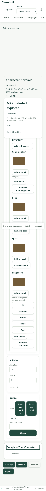

# Item images — hosted acceptance

M2 passed hosted acceptance on application `dafdcffab7e9d7fea6e9e0cd6ba7eee428a559bb`
and CI #210. The full PR still requires M3.

The module/HTTP cases began red with missing image routes. They now cover system
publication, later draft replacement, clone, complete export/import with rescan,
foreign asset denial, campaign audiences and membership generations, private
proposal art with exact reviewed-image approval, retained placed copies after
catalog narrowing/replacement and character return, per-entry overrides, replay,
duplication and removed-entry identity reuse. A paused duplication test reproduced
a stale rules snapshot before its revision guard was added. A contradictory shared
file descriptor imported successfully before the complete manifest check was added.

Local validation:
- Root type check and 488 unit cases passed (10 database cases skipped in that command).
- Database suite: 388 passed; one schema inventory expectation missed the newly
  created primary-key index. The corrected current-schema suite passed all 11 cases.
  The unchanged session-burst budgets passed (creation p95 228 ms, reads 16.3 ms,
  bumps 21.2 ms and rolls 22.3 ms).
- Full web suite passed 1,206 cases before the final two retry/approval cases;
  subsequent focused checks include those cases. Type check and production build passed.
- Shared editor red/green cases cover exact retries across parent edits,
  malformed successes and disconnect/reconnect, offline privacy and independent play.
- Generated contracts check passed; the generator's output buffer now supports
  the larger complete API without truncating its generated client declarations.

The dedicated hosted runner uses one GM and three player sessions. Setup and
cleanup use normal application APIs; artwork upload/edit, reviewed approval and
sheet play use the routed GUI. It will exercise three published template images,
clone/import/export, personal overrides, private catalog audiences/previews,
proposal privacy, retained copies, offline edits and return. Actual deployment,
results and screenshots will be recorded after it runs.

Only the isolated branch preview is used. A new disposable database preserves
all earlier preview databases. Production sources and migration policy are unchanged.

## Hosted result

PASS, 55.2 seconds, isolated `sweetroll-d2` deployment
`1f4429d5-b85e-4c1f-b067-4faabfd6a587`, source branch
`docs/system-themes-and-images`, commit `dafdcff`. Its branch/source and successful
deployment were checked before running. Database `sweetroll_pr30_m2` uses the
current schema; earlier databases are preserved. The private real ClamAV scanner
and mounted media volume remain in use.

The one-GM/three-player runner passed all listed workflows, including GUI art
uploads for weapon/spell/equipment, displayed personal overrides, exact portable
art, audience preview for each player and direct-byte denials, illustrated private
suggestion approval, source replacement/archive, retained copies, 360px axe with
zero violations, no page overflow, offline placeholder/edit/reconnect and a roll
after return. The phone screenshot was inspected:

Runner corrections used the actual command-response envelope and scrolled lazy
cards into view before image assertions. Cleanup now returns attached characters
before archiving; the exact interrupted fixture was separately cleaned up. The
successful run archived its created character, campaign and three systems.

CI #210 (`41871779956`) passed verify (including database integration, contracts,
Docker), web, all three browser journey shards, offline and visual checks.
Production deployment was skipped. A subsequent focused red/green portrait case
preserves file-reader cancellation when the shared file control changes character.
Its small follow-up awaits the next branch CI; it does not change accepted item
workflows. Human/device/provider/table-play G9 gates remain separate.
