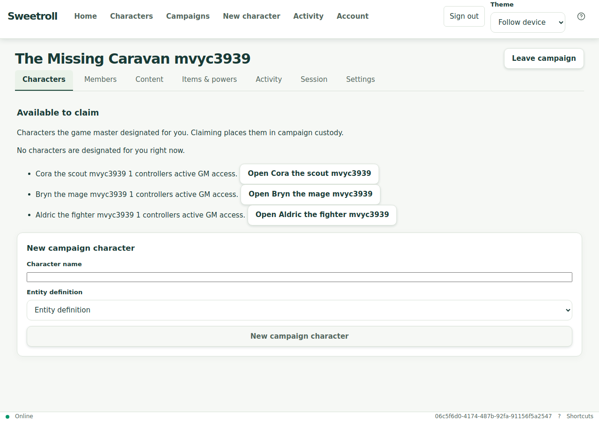
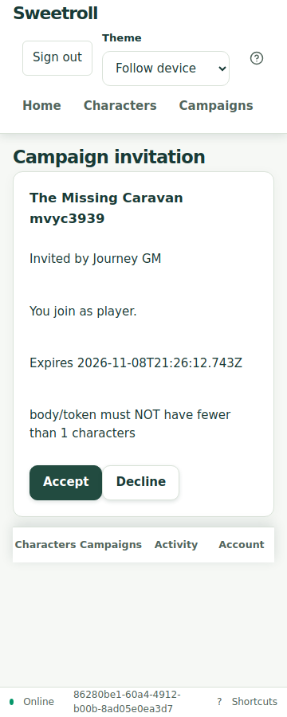
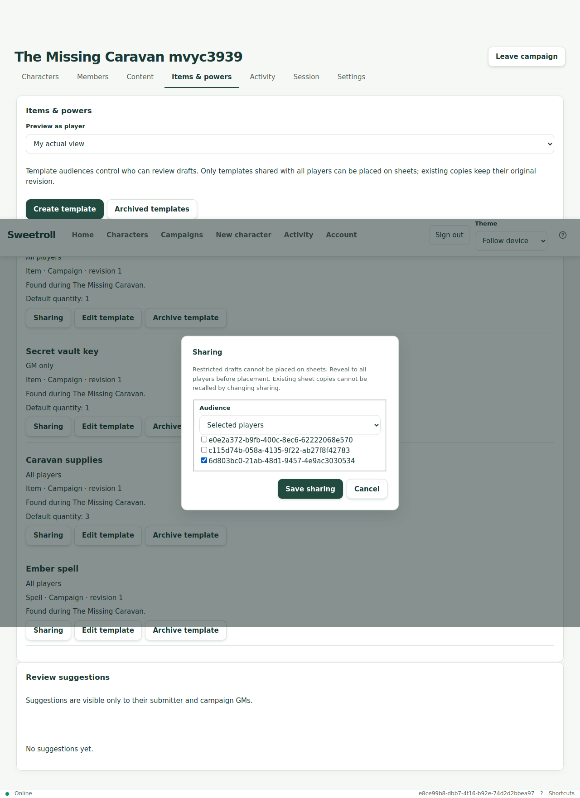

# Sweetroll – fleranvändarjourney, 1 november 2026

**Bedömning: huvudflödet fungerar med alternativa vägar, men hela onboardingflödet är inte godkänt.** Testet upptäckte ett reproducerbart fel i manuell inbjudningsacceptans och en lucka för att koppla en befintlig personlig karaktär till en kampanj genom gränssnittet.

**Repository handoff:** Historical execution; F1–F3 remain OPEN. The next work is
[bug remediation](../superpowers/plans/2026-11-01-multi-user-journey-remediation.md),
then the complete [ordered rerun protocol](multi-user-journey-protocol.md).
This report is not post-fix acceptance. [Sanitized evidence](multi-user-journey-2026-11-01.json).

## Miljö och metod

- Fyra olika testidentiteter: en GM/ägare och tre spelare i separata webbläsarkontexter med egna sessioner. Inga riktiga spelare kontaktades.
- Körning mot den driftsatta testmiljön https://sweetroll-d2-preview.up.railway.app. Railway-projekt `sweetroll-d2-acceptance`, miljö `preview`, tjänst `sweetroll-d2`.
- Deployment `fc6d8088-68f9-42ef-9768-2f3677e4f2e8` var SUCCESS, källa `78dad8c9620ce700ffe9f6b8c55225e237b11d90`. Jämförelse med main `af2b076dfd44460501fed8002990f92f4b373efb` visade enbart två ändrade dokumentationsfiler; applikationskod, schema och byggkonfiguration var identiska.
- Chromium/Playwright, bredder 360, 768 och 1280 px. Verkliga HTTP-anrop och sparad serverdata användes; ingen simulerad backend.
- System, publicering, kampanj, anteckningar, inbjudningar, karaktärer, mallar, föremålsplacering och slag kördes genom GUI. Testinloggningen använde den befintliga testidentitetsfunktionen. En fristående karaktär kopplades via befintligt API eftersom motsvarande GUI-steg saknas. Två karaktärer skapades direkt i kampanjen genom GUI.

Den avsedda tjänsten `sweetroll-acceptance` kontrollerades först: main, deployment `93bcdd8f-efd1-4628-bbfa-c0dc8625f3cb`, SUCCESS, `/health/ready` 200. Den kör dock `auth mode active: locked (dev sign-in routes disabled)`. En ny anonym användare saknar fungerande inloggningsväg där. Därför användes den befintliga D2-testmiljön. Ingen driftkonfiguration ändrades.

## Scenario

Från ett tomt system byggdes **Tower of Ash** med d20, attributen Might/Agility/Will, ett karaktärsblad och separata platser för utrustning respektive spells. Systemet publicerades som 1.0.0.

| Post | Ursprung | Beteende som provades |
| --- | --- | --- |
| Longsword | System, item | d20 + Might för attack; d8 + Might för skada |
| Firebolt | System, spell | d20 + Will för kast; d6 + Will för skada |
| Rope | System, item | Skapande och publicering av vanlig utrustningsmall |
| Ashguard blade | Kampanj, från Longsword | Ärver validerade attack- och skadeactions |
| Ember spell | Kampanj, från Firebolt | Ärver validerade spellactions |
| Caravan supplies | Kampanj, data | Utrustning med standardantal 3 och oberoende karaktärskopior |
| Secret vault key | Kampanj, data | GM-hemlig → utvald spelare → avslöjad för alla → hemlig igen |
| Lucky token 1–3 | Personliga poster | Namn, beskrivning, anteckning, antal 2, sparning och återöppning |
| Offline trail ration | Personlig post | Skapande offline, omladdning och synkronisering exakt en gång |

Äventyret **The Missing Caravan** representerades av en kampanj med offentlig briefing, GM-hemlig anteckning, föremålskatalog och tre spelarstyrda karaktärer.

| Spelare | Karaktär | Might | Will | Skapande |
| --- | --- | ---: | ---: | --- |
| 1 | Aldric the fighter | 2 | 4 | Fristående via GUI; koppling till kampanj via API |
| 2 | Bryn the mage | 3 | 3 | Direkt i kampanjen via GUI |
| 3 | Cora the scout | 4 | 2 | Direkt i kampanjen via GUI |

## Verifierade resultat

| Flöde | Resultat |
| --- | --- |
| Skapa system från tomt utkast, attribut, föremål och blad; publicera | Godkänt |
| Skapa kampanj/äventyr och anteckningar med olika målgrupper | Godkänt |
| Utfärda inbjudningar och ansluta genom inbjudningslänk | Godkänt för alla tre spelare |
| Manuellt klistra in token, granska och acceptera | Underkänt för alla tre spelare, se F1 |
| Tre egna karaktärer och sex sparade poster per karaktär | Godkänt; 18 poster före extra offline-/delningskontroller |
| Rätt typ av föremål i rätt plats | Godkänt; spellval saknas i utrustningsplats och vapenval saknas i spellplats |
| Vapen-/spellslag och ärvda kampanjactions | 18 inledande slag godkända med väntade resultatintervall |
| Samtidiga spelarsessioner | Ytterligare sex slag godkända; rå tärning + exakt rätt attributvärde verifierades i serversvaren |
| Öppna blad igen och återfinna sparade poster och actions | Godkänt |
| Spelare försöker öppna varandras blad | Nekas med 404 och otillgänglig vy |
| Spelare försöker administrera mallar eller läsa hemlig mall via direkt ID | Nekas; hanteringsknappar saknas |
| GM öppnar samtliga tre blad | Godkänt |
| Utvald mottagare och GM:s spelarförhandsvisning | Godkänt; övriga spelare får 404 för den begränsade mallen |
| Begränsad mall får inte placeras före avslöjande | Godkänt |
| Explicit avslöjande, placering, därefter ändrad synlighet | Godkänt; befintlig bladkopia består medan nya placeringar blockeras |
| Ändra antal utrustning på ett blad | Godkänt; annat blad och kampanjmall behåller antal 3 |
| Offlinepost, omladdning, återanslutning | Godkänt; exakt en sparad post efter synk |
| Horisontell sidscroll på blad vid 360/768/1280 px | Ingen i de kontrollerade vyerna |

Totalt genomfördes **24 lyckade slag** i denna journey. De sex samtidiga anropen kontrollerades med faktisk tärning, bindings och total, utöver intervallkontrollen för de första 18 slagen.

## Fynd och prioritet

### F1 – Hög: manuell inbjudningsacceptans skickar tom token

1. GM utfärdar en spelarinbjudan.
2. Spelaren öppnar inbjudningsvyn utan token i länken och klistrar in en giltig token.
3. **Review invitation** visar korrekt kampanj, inbjudare och roll.
4. **Accept** misslyckas med HTTP 400: `body/token must NOT have fewer than 1 characters`.

Felet reproducerades för samtliga tre testspelare. Samma inbjudan fungerade genom den befintliga inbjudningslänken, och det flödet verifierades fram till aktivt medlemskap och läsbar briefing. Det är alltså inte en ogiltig eller utgången inbjudan.

Kodgranskningen visar en återkoppling mellan `activeToken`, `describeError`, `runReview` och initieringseffekten: manuell tokenändring ändrar callback-identiteten, varefter effekten återställer aktiv token från den tomma URL-parametern. Det senare är orsaksanalys från koden; HTTP-felet och länkalternativet är observerade beteenden.

Åtgärd: skilj initiering från ändringar i aktiv token och lägg ett GUI-regressionstest för manuell token → granskning → acceptans. Prova även avslag från samma manuella väg.

[Kod: InvitationReview.tsx](https://github.com/Kajonn/sweetroll/blob/af2b076dfd44460501fed8002990f92f4b373efb/web/src/campaigns/InvitationReview.tsx#L90)

### F2 – Medel: befintlig personlig karaktär saknar GUI-väg in i kampanjen

En spelare kan skapa en ny karaktär direkt i kampanjen; detta verifierades för två spelare. Däremot hittades ingen GUI-funktion för att koppla in den befintliga fristående karaktären. Den första spelaren behövde därför den befintliga, behörighetskontrollerade API-operationen för adoption. Detta är en funktionslucka i GUI-flödet, inte ett fel i den provade backend-operationen.

Åtgärd: erbjud val av egna kompatibla karaktärer från kampanjen eller karaktärsbladet, med tydlig bekräftelse om GM:s åtkomst. Behåll möjligheten att skapa direkt i kampanjen.

[Kod: CampaignCharacters.tsx](https://github.com/Kajonn/sweetroll/blob/af2b076dfd44460501fed8002990f92f4b373efb/web/src/campaigns/CampaignCharacters.tsx)

### F3 – Medel, användbarhet: mottagare och förhandsvisning visar UUID

Delningsdialogen och valet av spelare använder fullständiga användar-ID:n som etiketter. Behörigheterna fungerade i testet, men en GM behöver kunna känna igen rätt person. Visa visningsnamn med en kompletterande särskiljare när det behövs.

[Kod: TemplateSharing.tsx](https://github.com/Kajonn/sweetroll/blob/af2b076dfd44460501fed8002990f92f4b373efb/web/src/campaigns/TemplateSharing.tsx)

## Avgränsningar och städning

Testet använder testidentiteter och emulerade skärmstorlekar. Det verifierar inte Google/OIDC-inloggning, faktisk Android/iPad-interaktion, installation på en fysisk enhet eller ett riktigt bord-/distansspeltest. Inga JavaScript-fel registrerades i webbläsarnas pageerror-kontroller. Det är ett funktionsprotokoll för denna journey och innebär inte att alla releasekrav eller hela CI-sviten har körts om.

Testharnessen justerades för aktuella etiketter, asynkron sparning och rätt API-kontrakt. Sådana harnessfel räknas inte som produktfel; F1–F3 och miljöhindret ovan redovisas separat.

Endast resurser skapade i denna körning städades: tre karaktärer, fyra kampanjmallar och kampanjen arkiverades; systemet gjordes privat och arkiverades. Status kontrollerades genom separata läsningar efter varje ändring. Inga användarresurser raderades och inga applikationsändringar implementerades under testet.

**Rekommenderad ordning före nästa feature:** rätta F1, komplettera GUI-vägen för befintliga karaktärer och gör spelarmottagare begripliga. Kör sedan om inbjudnings- och kampanjanslutningsflödet utan alternativa API-steg.

## Bevarad visuell evidens

Bilderna visar den historiska testkörningen före arkivering och använder enbart syntetiska testidentiteter.

