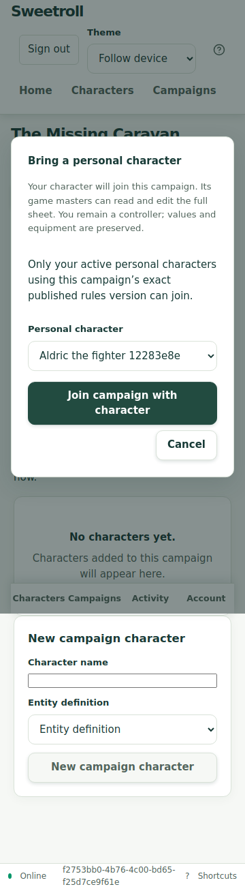
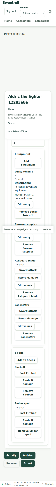
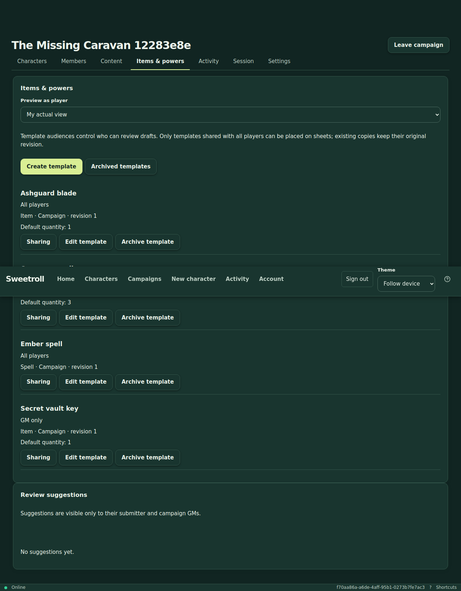
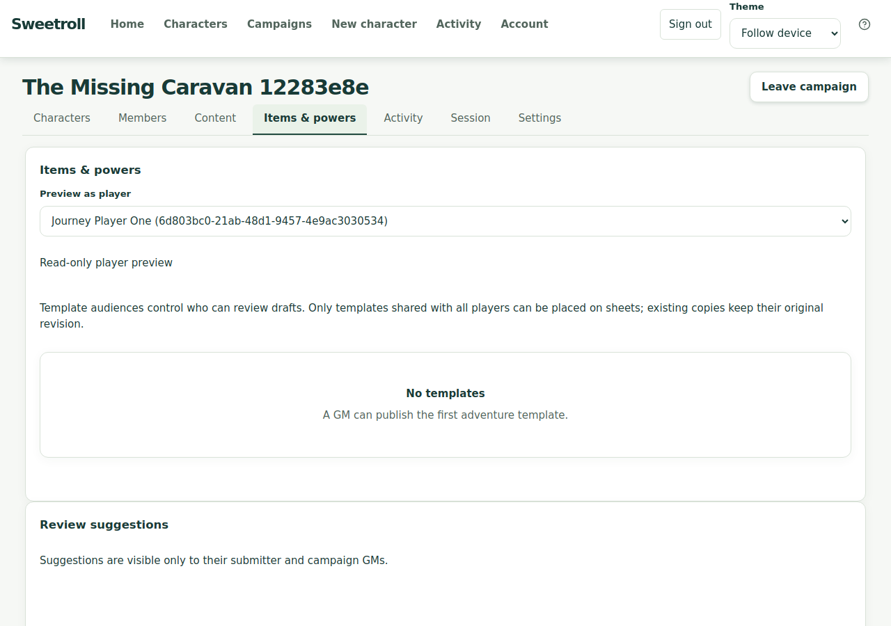
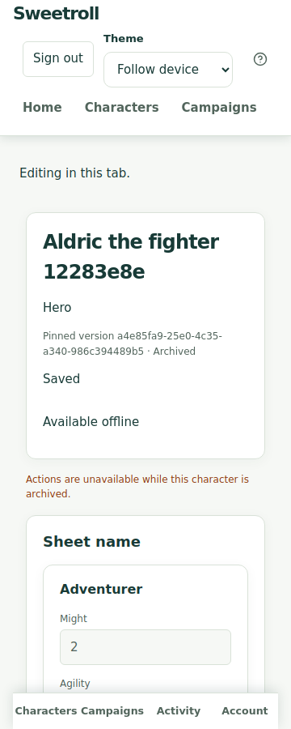

# Sweetroll – post-fix fleranvändarjourney, 2 november 2026

**Resultat: GODKÄNT för hela MU-00–MU-12.** En GM och tre spelare genomförde samma ordnade [protokoll](multi-user-journey-protocol.md), från tomt system till arkivering. Alla **24 slag** och alla 13 steg passerade. F1–F3 och testmiljöblockeringen E1 är verifierade inom denna acceptans. Körningstid: **144.743 s**, en worker, noll automatiska retries, oförändrad totalgräns 360 sekunder.

[Maskinläsbar evidens och samtliga slag](multi-user-journey-2026-11-02.json). Den [historiska rapporten](multi-user-journey-2026-11-01.md) är oförändrad och beskriver de ursprungliga felen och dåvarande alternativa vägarna.

## Exakt testmiljö

| Del | Verifierat värde |
| --- | --- |
| URL | https://sweetroll-d2-preview.up.railway.app |
| Railway-projekt / miljö / tjänst | sweetroll-d2-acceptance / preview / sweetroll-d2 |
| Applikationscommit | `a1fc29907c6462784caf99f81ed24c6489d45e81` |
| Branch | `docs/multi-user-journey-remediation` |
| Deployment | `affa05b3-c796-42b0-8e63-7df0faf21771`, terminal SUCCESS |
| Bygg-ID | `build-mvz6rlb5` |
| Backendidentitet | Pinned source SHA, lyckad Docker-build och runtime/readiness på samma deployment; image digest i JSON-evidensen |
| Frontendidentitet | HTML, JS, CSS, worker, offline-manifest och PWA-manifest jämförda byte för byte med lokal rebuild av samma källa och bygg-ID; samtliga matchar |
| Autentisering | Befintlig explicit test-auth; fyra separata sessioner och olika verifierade aktörer |
| Webbläsare | Chromium 130 / Playwright 1.48; vybredder 360, 768, 1280 px |
| Färska testdata | Suffix `12283e8e`; inga historiska resurser återanvändes |
| Runner | `web/tests/fixtures/multiUserJourney.ts`, Git-blob `de9b268fcdbd3bba8fd1b144acc6bc7265a8b450` |

Tjänsten uppdaterades från `bfddc95` till den CI-godkända commiten ovan. Projektet har endast previewmiljön. Övriga projekt och tjänsters källor ändrades inte. Testet använder den riktiga driftsatta frontend/API:n och PostgreSQL. API-kontroller gör riktiga, ej cachade anrop med respektive aktörs session; de ersätter inga användaroperationer eller serversvar. Fixtureinloggning och avgränsad API-arkivering följer protokollet.

Applikationen är oförändrad efter `a1fc299`: denna verifieringsändring rör runnerns HTTP-transport/sparsynkronisering och dokumentation. Testmiljön är fortsatt låst till den testade applikationscommiten. Testet använder miljöns proxy; certifikattoleransen i den befintliga hosted-konfigurationen är en runnerinställning.

## Resultat per protokollsteg

| Steg | Genomfört | Resultat |
| --- | --- | --- |
| MU-00 | deployment/fixture preflight | PASS |
| MU-01 | GUI blank-system authoring/save/reopen/publish | PASS |
| MU-02 | GUI adventure and public/GM-only notes | PASS |
| MU-03 | three manual token reviews and accepts | PASS |
| MU-04 | personal creation/GUI adoption and two direct campaign creations | PASS |
| MU-05 | inherited and blank adventure templates | PASS |
| MU-06 | six entries and six actions for each player | PASS |
| MU-07 | reopen/responsiveness and authorization | PASS |
| MU-08 | six concurrent actor-bound rolls | PASS |
| MU-09 | named restricted recipients/actual preview/reveal/narrow | PASS |
| MU-10 | production-worker offline pending/reload/replay | PASS |
| MU-11 | independent placed-copy quantities | PASS |
| MU-12 | scoped archive and independent readback | PASS |

- **F1:** alla tre spelare klistrade in en färsk token utan URL-token, granskade och accepterade. Testet verifierade HTTP 200 och att skickad token var den granskade. Ingen länkalternativväg användes.
- **F2:** spelare 1 skapade sin personliga Aldric och valde den i kampanjens GUI, såg informationen om GM:s åtkomst och bekräftade anslutning. Ingen adoption gjordes direkt från testkod via API. Bryn och Cora skapades direkt i kampanjen.
- **F3:** delning och förhandsvisning använde igenkännbara spelarnamn med stabil ID-disambiguering. Sparade mottagar-ID:n och medlemskapsgenerationer, riktiga spelarkataloger, nekade läsningar och preview-paritet verifierades.
- **Slag:** 18 i ordning och ytterligare 6 samtidigt över aktörerna. Varje serversvar verifierades mot vald karaktär, entry/action, rätt tärningssidor, fältbinding och total = faktiskt tärningsvärde + rätt Might/Will.
- **Integritet:** andra spelares blad och hemliga mallar gav 404; aktiv spelares administrationsförsök gav exakt 403/`forbidden`. Begränsad mall kunde inte placeras före avslöjande. Redan placerad kopia fanns kvar efter begränsad synlighet.
- **Offline:** samma sparade köpost, entry-ID och innehåll överlevde offlineomladdning. Återanslutningen skickade samma post; kön tömdes och exakt en bekräftad ration fanns på servern och bladet.
- **Oberoende antal:** spelare 1:s Caravan supplies sparades som 2; spelare 2:s kopia och kampanjmallen behöll 3.
- **GUI:** ingen horisontell overflow i de kontrollerade spelarvyerna. GM:s katalog kontrollerades vid 360/768/1280 px i light/dark. Axe hade noll violations i den kontrollerade katalogvyn; inga page errors registrerades.

## Försök och rättningar av runnern

De två tidigare försöken redovisas som FAIL. Slutkörningen startade om hela sekvensen med färska resurser; automatiska retries är 0.

| Försök | Resultat | Orsak och verifiering |
| --- | --- | --- |
| 1 | FAIL, MU-04 | Sparandet gav 200 och rätt inskickat attribut, men APIRequestContext-återläsningen hann inte slutföras inom expect.poll:s 5 sekunder. Fristående återläsningar tog 4,2–6,6 s och bekräftade korrekt Might=2. Skapade resurser arkiverades. |
| 2 | FAIL, MU-12 | MU-00–MU-11 passerade, inklusive 24 slag och offline. Proxyanslutningar för API-observationer/städning förbrukade totalbudgeten; timeout inträffade på sista systemåterläsningen. Separat senare läsning verifierade samtliga arkiveringar och privat system. |
| 3 | PASS, MU-00–MU-12 | API-observationer och avgränsad städning återanvänder respektive webbläsares anslutning, samma autentisering och riktig API-policy. Oförändrade steg, workload, assertions, tidsbudget och retries. |

Attribut kontrolleras efter lyckat sparsvar; antaländringen har ett explicit PATCH-svar före fristående återläsning. Ingen ny applikationsbugg upptäcktes under dessa två runnerfel. Första försökets sparade värde och andra försökets slutstatusar verifierades separat. Sessionscookies och inbjudningstokens publiceras inte; en tillfällig fixturesession i feldiagnostiken återkallades och diagnostikkopior redigerades.

## Regressioner och körkommandon

[CI #187](https://github.com/Kajonn/sweetroll/actions/runs/41437546639) på den driftsatta applikationscommiten är grön i samtliga sju verifieringsjobb: backend/unit/integration/contracts/build/Docker, frontend, tre browserjourneys, visual och production-worker offline. Alla 31 offlinetester passerade där. Den slutliga runnern och denna evidens levereras i [PR #28](https://github.com/Kajonn/sweetroll/pull/28).

En isolerad red-kontroll körde de nuvarande testerna mot enbart de tre gamla komponentfilerna InvitationReview/TemplateSharing/CampaignTemplates från `c2a1341`; övrig källa och tester var från `a1fc299`. Då misslyckades **6 av 20** fall: de manuella accept/decline-flödena, korrigering av ogiltig manuell token, sen mutation/navigation samt namngivna mottagare och preview. Med de rättade komponenterna är motsvarande tester gröna. F2:s historiska red-evidens är den saknade GUI-vägen i rapporten den 1 november; den nya vägen verifieras av fyra fokuserade tester och den fullständiga hosted-journeyn.

Följande fokuserade tester kördes också lokalt den 2 november och passerade: InvitationReview 8, AdoptPersonalCharacter 4, TemplateSharing 2, CampaignTemplates 10 och FieldControl 7, totalt **31**. Frontendens typkontroll passerade.

```sh
cd web
npm test -- src/campaigns/InvitationReview.test.tsx src/campaigns/AdoptPersonalCharacter.test.tsx src/campaigns/TemplateSharing.test.tsx src/campaigns/CampaignTemplates.test.tsx src/characters/FieldControl.test.tsx
npm run typecheck
OFFLINE_BUILD_ID=build-mvz6rlb5 npm run build
MULTI_USER_ACCEPTANCE_URL=https://sweetroll-d2-preview.up.railway.app \
MULTI_USER_ACCEPTANCE_OUTPUT_DIR=test-results/multi-user-hosted-2026-11-02/run-3 \
npx playwright test --config playwright.multi-user-acceptance.config.ts
```

## Inspekterade bilder







Kompletterande viewportbilder togs genom enbart läsning efter arkivering:





Fullsidesskärmbilderna bevarar den aktuella scrollpositionen för fasta/sticky delar; navigering kan därför synas mitt i den sammansatta bilden. De kompletterande viewportbilderna börjar överst på sidan. Bildmaterialet är avgränsad visuell evidens; den bredare visuella G9-matrisen är fortfarande öppen.

## Städning och begränsningar

Slutkörningen arkiverade sina **3 karaktärer, 4 kampanjmallar och kampanjen**. Systemet gjordes privat och arkiverades. Statusarna lästes tillbaka oberoende. Båda misslyckade försöken är också avgränsat städade; andra försökets kompletterande återläsning finns i JSON-evidensen. Ingen databas återställdes och inga resurser raderades.

Denna acceptans gäller MU-00–MU-12 och F1–F3/E1. Verklig providerinloggning, fysiska Android/iPad-enheter, fysiskt bordsspel/distansspel och övriga G9-releasekrav är fortsatt öppna. Ingen applikationsrelease, produktionsinloggning eller migreringsacceptans påstås.
