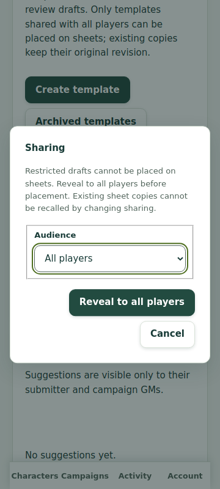
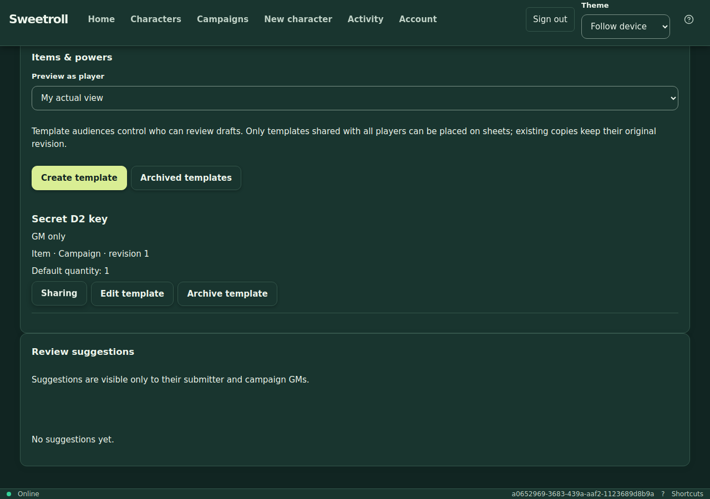

# D2 restricted campaign-template audiences — acceptance

Original full-journey application: `5f445aa57f3f6966b7fbe8daa01219d22d8f4818`.
PR: [#27](https://github.com/Kajonn/sweetroll/pull/27).
Contract: [restricted audiences](../superpowers/specs/2026-10-31-restricted-template-audiences.md).
Plan: [D2 execution](../superpowers/plans/2026-10-31-restricted-template-audiences.md).
Delivery commits through `41c74c3` add tests/documentation only. The later backend UUID
validation follow-up is recorded below. No migrations or old-client/version transition
adapters were added.

## Verification

- TDD baseline `0176b37`, CI #168: four new HTTP/PostgreSQL cases observed red before
  implementation (restricted creation was rejected by the original strict contract).
- CI #173 on `61cd5a8`: all seven verification jobs green. Includes 472 root tests,
  348 real PostgreSQL tests, 1,180 frontend tests, 62 normal browser journeys,
  30 production-worker offline checks, ten retained visual checks, typechecks,
  generated-contract identity, builds and Docker.
- CI #173 verify initially failed the unchanged campaign-load roll p95 gate at
  504.7175 ms versus 500 ms. One explicit verify-job rerun passed; no workload,
  latency limit, assertion, retry policy or visual baseline was changed. This is
  runner-sensitive load evidence, not a guarantee of production latency.
- Final [CI #174](https://github.com/Kajonn/sweetroll/actions/runs/41286553573) on
  `34309f9` passes all seven verification jobs on the first attempt: 472 root,
  **350 real PostgreSQL**, 1,180 frontend, 62 normal browser, 30 production-worker
  offline and ten visual checks, contracts, typechecks, builds and Docker.
  This includes deterministic placement/sharing-race and private-export tests.
  Campaign read/write/bump/roll p95: 24.4/40.3/139.8/143.6 ms; standalone
  create/read/bump/roll p95: 171.8/13.8/24.6/58.5 ms. Workloads/limits unchanged.
- Local Node 24.22.1: 1,180 frontend tests passed; targeted sharing/cache/roster suite
  10/10; frontend/backend typechecks/builds and generated contracts passed.

The new server tests cover current-generation grants, private list/direct IDs,
filtering before pagination, cursor scope, actual-player preview parity, all four
kinds, same-key replay, demoted-manager replay denial, concurrent sharing writes,
transaction rollback after grant changes, independent copies and explicit reveal.
Existing C/D1, archive/recovery and current authorization gates remain intact.

## Observed findings repaired

- Preserve the existing explicit conflict for a previously selected archived public
  template. Hidden templates return not-found at initial resolution and again in
  the locked character commit; they never become a sheet snapshot.
- Separate real/preview/role/offline query keys. Purge both catalog and base queries
  on scope exit; late completions cannot recreate private former-scope data.
- Block replacement of sharing grants until the entire paginated roster is loaded,
  preventing a save from dropping recipients on an unloaded page. Its new regression
  was observed red, then green.
- Change theme foreground/background colors together. Existing browser axe checks
  caught low intermediate contrast from independent palette transitions; final
  palette colors and retained visual baselines are unchanged.
- Restricted creation says **Save draft**; publication/reveal explicitly identifies
  the audience. Frozen uncertain requests retain exact payload and key.

New test-fixture corrections are distinct from product findings: schema inventory
includes the grant relation/index; replay assertions inspect `reconciliation.replayed`;
the offline badge belongs to the character sheet. Campaign navigation intentionally
is outside the character-only offline shell allowlist: offline catalog reload must
fail closed and expose no private content. Character copies must still reopen.

## Isolated hosted application

Project `sweetroll-d2-acceptance` (`f1770b85-8e58-4b99-b981-dc76e106a2c9`),
environment `preview` (`0382c61c-327d-4336-be1b-ec4d81a6d5e7`).
App `sweetroll-d2` (`b2c4d538-67a7-4533-8707-8a5eccab1870`), PostgreSQL
`3b957322-c433-4c4c-9525-74ec16853110` with a new disposable database.

URL: https://sweetroll-d2-preview.up.railway.app
Original full-journey deployment: `f23a7773-3492-4917-851e-25f92071bf20`, terminal **SUCCESS**, source
pinned to the application above. `/health/ready` returned `{"status":"ok"}`.

The first isolated deployment failed database connectivity with the app in sfo and
its new database volume in `europe-west4-drams3a`. Colocating the app with the volume
resolved it. IPv6 egress and private-endpoint security settings were not changed.
Existing `proactive-expression` and `sweetroll-items-preview` services/data are intact.

[Served asset evidence](d2-assets-2026-11-01.json) records byte-for-byte identity for
HTML, entry JS, CSS, worker, offline manifest and PWA manifest. The source rebuild
uses the deployed `OFFLINE_BUILD_ID=build-mvxiqk5g`; its normal time-derived build ID
would otherwise differ. API responses were not substituted or mocked.

## Hosted normal and offline journeys

Chromium 130, one worker, zero retries, canonical 180-second journey timeout:

| Journey | Result | Duration |
| --- | --- | --- |
| Private drafts → selected grant → real-policy player preview → explicit all-player reveal → independent sheet copy | Passed | 33.298 s |
| Production-worker private-cache purge, denied offline catalog reload, reconnect/reveal, independent disclosed-sheet offline reload | Passed | 37.252 s |

Both run the checked-in `templateAudienceJourney`. Fixtures use GM, co-GM, selected
player and unselected player against real authenticated HTTP sessions and PostgreSQL.
Checks include direct IDs, negative discovery, generation-bound recipients, private
selector/IndexedDB exclusion, player preview parity, absence of GM controls in preview,
exact committed-but-unseen sharing retry, independent entries after narrowing,
service-worker control and absence of private catalog API cache keys. Cleanup is
scoped to resources created by each run.

Runner setup is not application behavior: the local sandbox's ESM loading stalled,
so esbuild compiled the unchanged canonical fixture/tests to CommonJS. Dependencies
were resolved from the same checked-in lockfile installs. The environment's trusted
HTTPS proxy required Chromium to pin its verified proxy-leaf SPKI; Node verified the
certificate normally. Local CONNECT pooling removes repeated 4–5-second tunnel
setup (measured reused request 171 ms); it changes no request/response or assertion.
Earlier runner attempts failed certificate/module setup and are not acceptance passes.
CI independently runs original TypeScript fixtures without these local adaptations.

[Independent cleanup readback](d2-cleanup-2026-11-01.json) covers all seven run manifests,
including failed runner attempts: characters, templates and campaigns are archived;
systems are private and archived. No deletion or retention feature was introduced.
No authentication cookies, private traces or credentials are committed here.

## Routed visual review and limits

Inspected actual hosted screenshots: mobile light reveal confirmation at 360×800,
and desktop dark catalog at 1280×900. Dialog text/buttons fit; audience and reveal
wording are visible; final foreground/background contrast is preserved. Existing
canonical campaign journey also checks 320/360/768/1280 overflow and dark-mode axe.

Recipient/preview choices reuse the existing roster's user-ID labels; recipients
are selected, never manually typed. Friendly roster names remain a usability follow-up.
The branch requires a fresh disposable database baseline, as used here; it contains
no upgrade path for an older unreleased test database. Catalog narrowing cannot erase
information already disclosed or recall materialized sheet copies. Physical Android/
iPad, production identity-provider sign-in and physical-table/remote playtests remain
separate G9 release gates. No public-release claim follows from D2 acceptance.

## UUID recipient validation follow-up (2026-11-01)

Backend follow-up `78dad8c` rejects duplicate recipient UUIDs regardless of letter case.
Previously the string-level duplicate check could miss a case alias and fall through
to PostgreSQL's unique constraint, returning 500 rather than the intended 400. The
new unit regression was observed red before case normalization, then green; the HTTP
integration test proves no mutation on rejection and accepts one uppercase recipient.
No frontend, HTTP schema, rule evaluation or migration behavior changed.

[Hosted probe and cleanup](d2-uuid-case-2026-11-01.json) verifies this on successful
isolated deployment `fc6d8088-68f9-42ef-9768-2f3677e4f2e8`, pinned to `78dad8c`:
case-aliased duplicates return 400, the complete original template is unchanged,
the uppercase-only recipient is canonicalized by persistence, and authorized player
discovery works. Only the probe-created template/campaign were archived, with
independent readback. An initial probe setup was corrected to read membership
generation from the member endpoint; its campaign cleanup is also recorded.

[CI #177](https://github.com/Kajonn/sweetroll/actions/runs/41344807801) passes all seven verification jobs on this follow-up: 473 root, 351 PostgreSQL and 1,180 frontend tests, plus the unchanged browser/offline/visual suites, typechecks, contract identity, builds and Docker.
Local Node 24 verification: 463 root tests passed with ten DB-dependent cases skipped;
17 targeted content/policy tests passed, plus typecheck/build and contract identity.
The original complete hosted browser journeys above remain historical evidence;
the deployed follow-up was verified with the focused HTTP/DB probe and canonical CI
browser/offline suites, since it only changes backend validation of invalid input.
