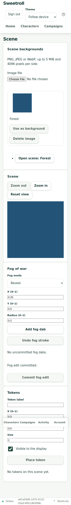

# Scene backgrounds — hosted acceptance

M3 passed the hosted journey, post-redeploy verification and CI #219 on
application `d62a9f8`. All requested feature stages are accepted. Final
documentation/workflow CI is tracked on the PR; broader G9 release gates remain open.

Inventory confirmed the existing Campaigns uploader and create/update APIs were
not reachable from an upload/select UI. The GM campaign page now links to its
scene library, with bounded named thumbnails, upload, create/open, preview,
confirmed replacement and explicit deletion. No new tactical behavior is added.

Red/green cases reproduced retained fog/tokens on replacement, missing catalog
routes and a GM demotion during original file I/O. These pass after atomic scene
reset, bounded GM catalogs/thumbnails and post-I/O authority/checksum checks.
A UI regression also reproduced uncommitted fog coordinates surviving the swap;
background identity now remounts viewport and fog/token controls. The shared file
control and existing display credential/redaction workflow are retained.

Local validation:
- 382 database integration cases passed with unchanged budgets (creation p95
  214.3 ms, reads 19.3 ms, bumps 29.1 ms and rolls 38.7 ms).
- 488 root unit cases passed; root/web type checks, generated contracts and web
  production build passed.
- 1,214 web unit cases passed, including confirmed replacement, exact request
  recovery after response loss, explicit stale-conflict refresh, revocation
  blanking, old fog-draft cleanup and existing scene/display regressions.

The hosted runner tests GUI upload/select/create/replace/delete, a concurrent GM
edit, a committed replacement with dropped response and exact retry, server-redacted
pixel colors, token reset, private-route denials, offline/reconnect and revocation.
It leaves only its successful campaign for a second post-redeploy checksum/pixel
verification, which then archives it. Final deployment and actual results follow below.
Physical device and human/table-play G9 gates remain separate.

## Continuation checks (2026-11-04)

CI #212 failed because two navigation-test role queries passed Playwright's
`exact` option to Testing Library. The red web typecheck reproduced both
TS2769 errors; removing the unsupported options preserves exact string-name
matching. Commit `889a7a0` passed the typecheck, 12 focused navigation/library/
viewport tests and production build; CI #213 passed every verification job.

The first hosted run (`41930176899`) exposed a runner race: the empty scene
route already has `?sceneId=`, so its URL assertion returned before creation
navigation completed. The corrected runner waits for the actual UUID before
pairing. Its next run (`41930549891`) passed upload/create, fog/token controls,
confirmed replacement, stale-conflict refresh, committed-response-loss exact
retry, redacted pixel assertions, token reset, deletion protection, unused-image
deletion and display-credential private-byte denials. It then failed axe's
`landmark-unique`: the outer scene section and viewport panel were both named
Scene. A focused regression reproduced two matching regions; removing the
redundant outer label leaves one and preserves the viewport's accessible name.
The six viewport tests, web typecheck and build passed after this correction.

Application `ad7f6751694dda5b368489c585446f999ebd135e` reached Railway SUCCESS
in deployment `2677427e-9c74-4b0f-905f-032f3510b5e4`. The branch remains
`docs/system-themes-and-images` on isolated `sweetroll-d2` in the preview
environment; the private scanner, database and mounted media volume are retained.
All six served HTML/JS/CSS/worker/manifest assets match the same-source rebuild
byte for byte using deployed build ID `build-mw2q74e6`. The complete hosted rerun
and subsequent redeploy verification are still pending at this checkpoint.

The next hosted checks passed axe and reproduced phone overflow: document width
362 at a 360px viewport. Geometry identified an unclassed native file control
with width 325 inside the 286px panel content. The shared image field and label
grids now use a bounded `minmax(0, 1fr)` track and a full-width, shrinkable input.
Eight focused shared-editor/scene-library tests passed. An automatic attempt
started before this deployment finished and therefore still observed the old
file control; it is not acceptance of the new build. The hosted workflow now
rebuilds and requires exact served JS/CSS identity before entering the journey.
The fixed application is `d62a9f8a91126b81ee5fcd0652994a97fef9d2a1`, deployed
successfully as `676dad75-acdf-4498-8388-0b134102844a`.

## Final hosted result

PASS on application `d62a9f8a91126b81ee5fcd0652994a97fef9d2a1`, deployment
`676dad75-acdf-4498-8388-0b134102844a`. [Hosted run 41932479903](https://github.com/Kajonn/sweetroll/actions/runs/41932479903)
passed in 26.8 seconds with zero retries. The complete ordered protocol passed:
GUI upload/select/create/replace/delete; concurrent GM edits and explicit refresh;
committed replacement with dropped response and byte-identical retry; atomic fog/
token reset; referenced-image deletion denial; server-redacted RGB pixels and
display-credential denial for originals, thumbnails, portraits and item art; axe
with zero violations; no document overflow at 360px; real offline/reconnect,
reload and revocation blanking. The GM and restricted-display screenshots were
inspected. All six frontend assets match the same-source rebuild byte for byte
using build ID `build-mw2qjof1`; the workflow also enforces exact JS/CSS identity
before entering the hosted protocol.

The same build was redeployed successfully as
`05d56016-005c-4970-af4e-eda79e37947e`. Only after Railway reported SUCCESS,
[verification run 41932851479](https://github.com/Kajonn/sweetroll/actions/runs/41932851479)
loaded the first run's fixture and passed in 3.9 seconds. The original bytes
retain SHA-256 `0aca948b375f3c627bce5879c7a8e8f4677b9f8efd20df2bce33e463a1ee9e81`;
scene background identity, cleared tokens and projection pixels remain intact:
revealed `[35,84,119,255]`, concealed `[0,0,0,255]`. It revoked the new display
credential and archived its campaign. A separate authenticated API read confirmed
that exact campaign is archived. Failed attempts also executed their scoped
archive cleanup; no unrelated resources were removed.

[CI #219](https://github.com/Kajonn/sweetroll/actions/runs/41932145088) passed all
seven verification jobs on the deployed application, including PostgreSQL
integration, contracts/types, Docker, web, three browser shards, offline and visual
checks. Production deployment was skipped. Subsequent changes contain evidence
and the manual hosted workflow only. The workflow is now explicit/manual so
ordinary PR updates do not mutate a shared preview. Run `create` against the
verified branch preview, retain its artifact/run ID, redeploy the same application,
wait for Railway SUCCESS, then run `verify` with that artifact run ID. No
production sources or obsolete-version migration code changed.

[Machine evidence](scene-backgrounds-2026-11-04.json) contains identity, timings,
checksums and independent cleanup readback. Existing physical-device, provider
login, human visual and table/remote-playtest G9 gates remain open.

