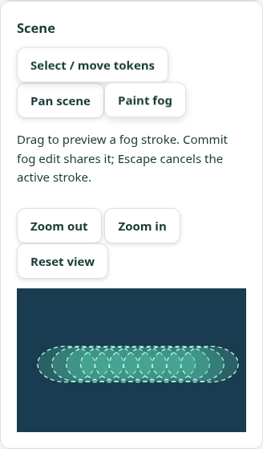
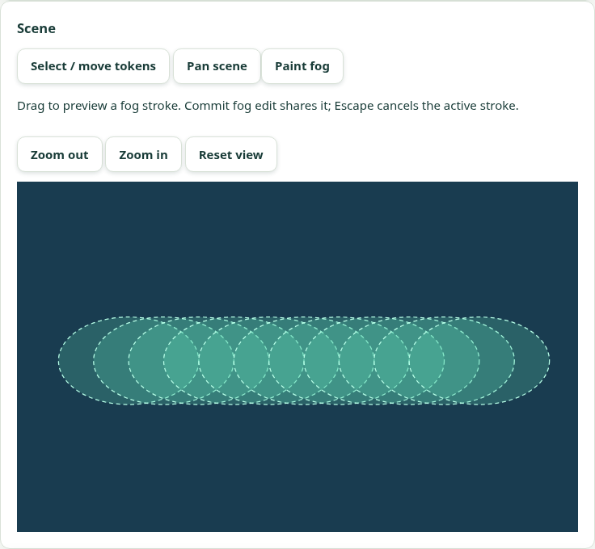
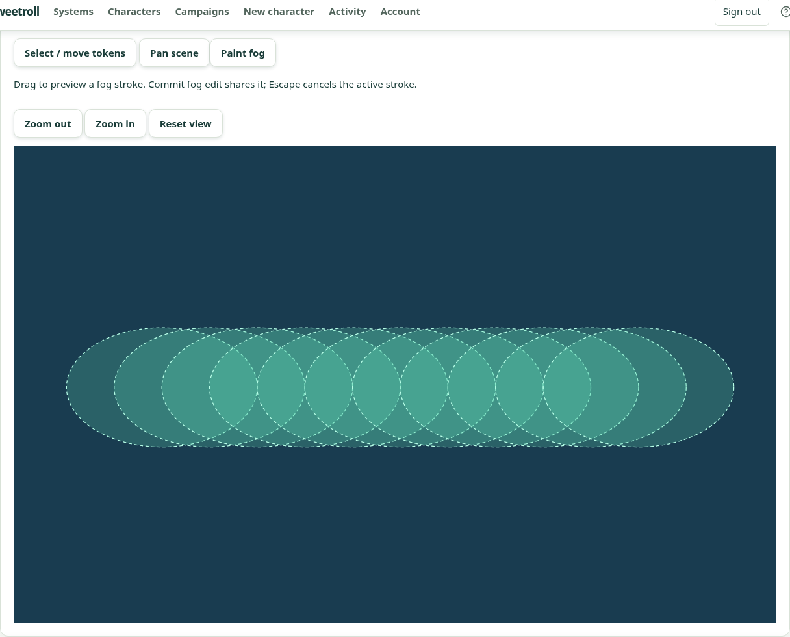

# V3 on-image fog brush — 6 November 2026

PR: https://github.com/Kajonn/sweetroll/pull/37 (stacked on #36).

Status: V3 implemented and accepted locally and on the isolated hosted preview.
Final branch CI is tracked in PR #37.
V4 combined ordered image-token/gesture/brush acceptance and aggregate G8/G9 remain open.

## Behavior

Reveal/Conceal and the adjustable radius now drive an on-scene mouse/touch brush.
The GM sees dimmed committed fog, a distinct colored local draft and the active
brush radius over the authorized original. The SVG and server circles use the same
normalized geometry, including non-square images and transformed scene layers.
A completed stroke adds bounded interpolated dabs, capped at 512 per draft.
Pointer jitter does not consume the sample budget. Painting never moves tokens.

Undo removes the latest completed local stroke; Escape, touch cancellation,
scroll/blur/resize, transform or mode/radius changes discard active input.
Commit explicitly publishes the completed draft. Numeric X/Y controls remain in
“Precise fog position” as a keyboard alternative. There is no per-sample request.

The draft freezes its first inspected revision. A conflicting scene write retains
it while reading the current scene, and requires an explicit retry with a fresh
key. Unknown outcomes retain the identical command/key. A saved command followed
by a failed read recovers only the read. Definite validation rejections allow
review/correction; denied commands remove protected content. Fog/token saves
share disabled/pending guards. Actor/scene/background/offline scope changes clear
unsafe drafts. The restricted display still uses only server-redacted saved bytes;
it does not import the GM overlay or request campaign originals.

No API/schema change, migrations, offline edit queue or new runtime dependency.

## Test-first and local evidence

Before implementation, mouse/touch preview and bounded sampling/overlay tests
failed (three assertion failures); the new draft-controller suite could not load
its missing module. Cancellation initially passed vacuously, then was verified
with active input. Two later regressions failed before corrections: changing
Reveal/Conceal during an active stroke still committed it, and a draft silently
adopted a newer revision instead of retaining its starting revision.

| Check | Result |
| --- | --- |
| Focused fog/gesture/tray/viewport component tests | 50 passed |
| Full frontend suite | 1,276 passed across 130 files |
| Frontend typecheck and production build | Passed |
| Actual PostgreSQL scene/media integration | 30 passed across campaign-scenes and campaign-item-images |
| Local real-HTTP browser journeys | 3 passed in 1.2 minutes, zero retries |
| Diff/whitespace checks | Passed |

The three browser journeys cover the historical restricted display, V2 image-token
placement/movement, and the new V3 brush. The V3 journey uploads/creates a background
and scene through the GUI and pairs an independent display. At 360, 768 and 1280px,
both mouse and native emulated touch paint on zoomed/panned scenes. It verifies
normalized coordinates, bounded dabs, radius preview, no writes before commit,
Undo and concealed display pixels before every commit. Escape and touchCancel
send no command. Reveal then Conceal are committed and checked using decoded
server-provided display image pixels, not visual overlay assertions.

Further checks use a real competing fog command for a conflict, and drop a real
successful response to verify byte-equivalent idempotent retry without a second
revision. Keyboard numeric input, reload/save retention, zero horizontal overflow,
axe, original-route denial, offline/reconnect draft cleanup, confirmed background
replacement and GUI revocation are exercised. Each fixture's display is revoked;
campaign archive cleanup is independently read back.

Local execution uses PostgreSQL 18.6 and the existing clean-image scanner fixture.
The workspace's socket restrictions require a temporary local runner using
`node --import tsx`, PostgreSQL TCP and a headless-shell binary with separate
browser contexts. These launch accommodations do not change repository runtime
configuration. CI and the hosted deployment retain their normal launch paths.

## Isolated hosted verification

Target: https://sweetroll-d2-preview.up.railway.app
Project `sweetroll-d2-acceptance`, environment `preview`, service `sweetroll-d2`.
Production and main-linked acceptance sources are unchanged.

| Field | Verified value |
| --- | --- |
| Application commit | `637a60f7b5718bc00a2a80c1df4cc566e4928aad` |
| Deployment | `483aa50c-e6fe-42da-bcd4-9704f8457c7a`, terminal SUCCESS |
| Readiness | `/health/ready` → `{"status":"ok"}` |
| Served JS | `/assets/index-YVS7s7JI.js` · SHA-256 `9c903a9a37aedea0883b040246b8b13d556abf599902ffa49a9aedd22db8e571` |
| Served CSS | `/assets/index-DF3Bkxz_.css` · SHA-256 `8d74655dc84143613f866c3f90298313a931a8f380e4c4b7927744f389421a55` |
| Build identity | Both served files and manifest asset names match the tested production build byte for byte |
| Final hosted journey | PASS in 80.1s total; 1 expected, 0 unexpected/skipped/flaky, zero retries |
| Cleanup | Display revoked; campaign archived and status independently read back |

The complete V3 journey passed twice against that exact application, with the final
run strengthening revocation proof: the real projection endpoint returns 200 with
its credential before GUI revocation and 404 afterward, including after the shell
clears its credential. Review caught and corrected an earlier probe using a
nonexistent route; that earlier 404 is not used as revocation evidence. Image
blanking, original denial and all other save/privacy assertions remain unchanged.
Only tests and evidence follow the deployed application commit.

[Machine evidence](scene-fog-brush-2026-11-06.json) records input coverage, results,
served assets and all six screenshot hashes. Hosted captures were inspected at
each width:

V4 still requires the full ordered combined image-token + gesture + brush hosted
protocol. Separate V2 and V3 runs do not close that aggregate gate. Physical-device
input, real provider login, human visual approval and actual table/remote G9
playtests are not covered by emulated touch.
