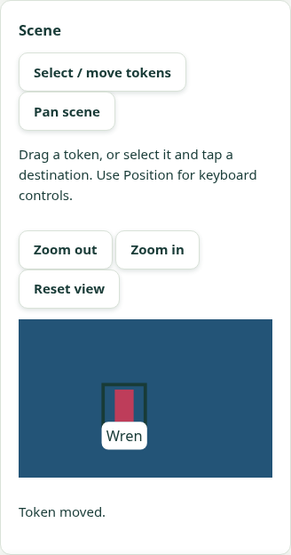
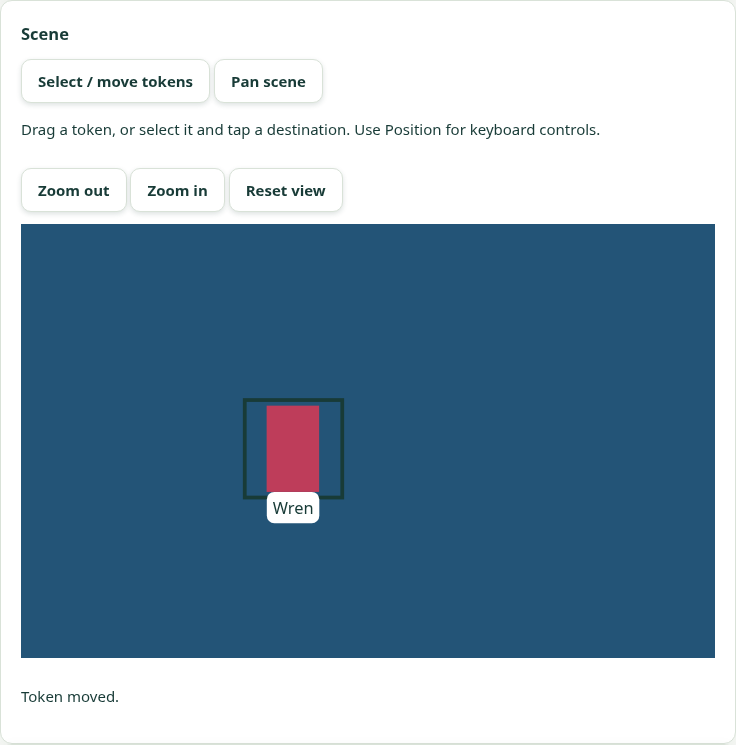
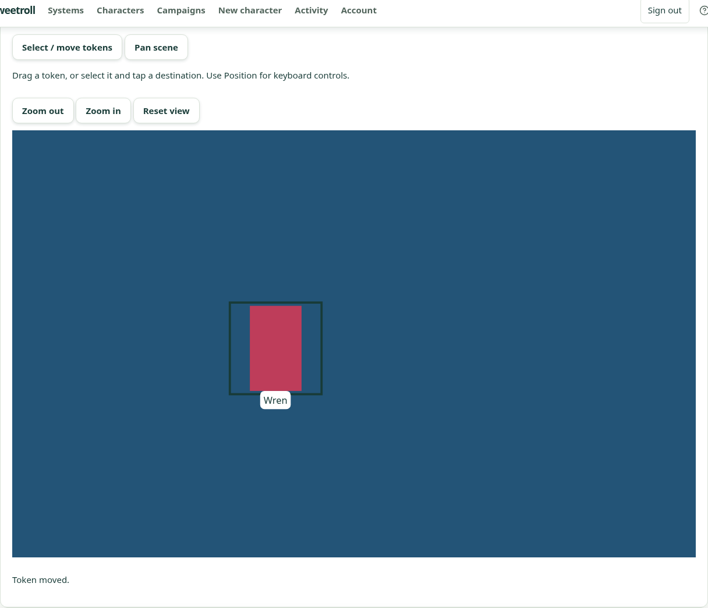

# V2 direct token placement and movement — 6 November 2026

PR: https://github.com/Kajonn/sweetroll/pull/36

Status: V2 implemented and accepted on the isolated hosted preview. Final branch CI is tracked in PR #36.
V3 fog brushing, V4 combined acceptance and aggregate G8/G9 remain open.

## Implementation

- The token tray arms a snapshot of a labelled uploaded-image or label-only token.
  Tap the scene to place it. Select/move mode supports dragging, or selecting a
  token then tapping its destination. Pan mode never changes token coordinates.
- Pointer capture tracks a local preview. A completed gesture saves once; Escape,
  touch cancellation, capture loss, page scroll, resize/blur, changed scene revision or scoped
  actor/scene/background/offline remount discards unfinished input. Grabbing a
  token off-center preserves that offset. Focus capture does not scroll the scene.
- Coordinates are bounded normalized positions computed from the actual transformed
  scene layer, including CSS scale/pan. Keyboard zoom/pan and numeric/nudge plus
  Move controls remain available. Saved coordinates refresh the precision fields.
- One token command owner serializes gestures and precision forms. Unknown outcomes
  retain the exact body/key; confirmed conflicts read the authoritative scene before
  an explicit fresh-key retry. Failed post-save reads recover the read without
  resending the already applied change. Denied commands remove protected content.
  Feedback and intended conflict/recovery coordinates appear beside the scene.
- No API/schema changes, migrations, new runtime dependencies or offline edit queue.

## Test-first evidence and local checks

The pre-implementation gesture suite had four failing tests (mouse/touch preview,
tap placement and pan); four cancellation checks initially passed vacuously because
no gestures existed. Later regression cases independently failed before fixes for
grab offset, protected-content removal after denied commands, scope-unmount read
cleanup and scrolling focus and scrolling during an active gesture. The completed suite exercises active gestures before
cancelling them.

| Check | Result |
| --- | --- |
| Frontend full suite before final feedback polish | 1,255 passed; the later focus test adds one case |
| Final affected viewport/gesture/command/tray tests | 36 passed |
| Backend unit suite | 489 passed, 10 database-dependent skipped |
| Actual PostgreSQL scene/media integration | 31 passed (PostgreSQL 18.6 local fixture) |
| Frontend typecheck and production build | Passed |
| Generated contracts | Passed using `node --import tsx scripts/generate-system-contracts.ts --check` |
| Final local Chromium regressions | Historical display journey + V2 journey: 2 passed in 31.1s, no retries |
| Whitespace/diff checks | Passed |

Local browser journey uses real HTTP, PostgreSQL and the existing bounded clean-image
scanner fixture. Background/scene creation, token-art upload, placement/movement,
keyboard controls, pairing and revocation use the GUI; independent API reads prove
saved state and archive cleanup. At 360, 768 and 1280px it verifies touch tap movement,
mouse dragging, native CDP touch dragging, zoom/pan and zero horizontal overflow.
Preview-only movement sends no request; each release saves once. Escape and native
touchCancel send no command. A real competing PATCH produces 409 and requires
explicit retry. A real applied request with its response aborted retries with the
identical key/body. Reload preserves the saved token; the separate display shows
its committed position. Axe reports no violations, offline hides editing, reconnect
restores it, revocation blanks display images, and cleanup independently reads back
an archived campaign.

The sandbox blocks Unix sockets used by tsx's launcher and standard Chromium. The
local-only runner uses `node --import tsx`, loopback TCP for PostgreSQL and a separate
headless-shell binary with normal multiple-process context isolation. No repository
runtime/dependency/config changes were made for these launch constraints. An initial
single-process browser launch incorrectly shared session state across contexts; that
launch was discarded. Early test targets also overlapped the token's label hit area;
the final test taps an unoccupied destination. Cleanup preserves the original failure.

## Hosted target

Only `sweetroll-d2-acceptance` / `preview` / `sweetroll-d2` is changed:
https://sweetroll-d2-preview.up.railway.app

| Field | Verified value |
| --- | --- |
| Application commit | `b112835cdbe5d697815124a4b7e0b04e8ed1eb61` |
| Deployment | `13b1f59e-2929-4ba8-8d8b-bffc56f22661`, terminal SUCCESS |
| Readiness | `/health/ready` → `{"status":"ok"}` |
| Served JS | `/assets/index-Dkse5Ljt.js` · SHA-256 `d67af8187c2d3599ec0028bbf47a703fe759862ee64f46dff474a8db7cb505cf` |
| Served CSS | `/assets/index-DF3Bkxz_.css` · SHA-256 `8d74655dc84143613f866c3f90298313a931a8f380e4c4b7927744f389421a55` |
| Source identity | Manifest assets and both files match the local final-source production build byte for byte |
| Hosted journey | PASS · 68.5s total · 1 expected, 0 unexpected/skipped/flaky, zero retries |
| Cleanup | Journey revoked its display and read back its archived campaign; one interrupted earlier V2 fixture was separately archived and read back |

The hosted run covered the same complete ordered V2 journey described above,
including all three widths, native touch, real stale-write conflict, exact
lost-response recovery and display/offline/revocation checks. No response or
server projection was mocked. Tests-only follow-ups update historical feedback
locators and wait for the actual response-drop handler to complete; the deployed
application bytes remain unchanged.

The initial hosted attempt reached the deliberately lost-response check before a
five-second assertion expired while the proxy-backed handler was still finishing.
The final test first awaits the bounded real fetch/abort, then asserts the same
uncertain state and exact retry body/key. All save/count/privacy assertions remain.
CI #256 exposed an older scene journey still locating feedback in the token tray;
it and the hosted G9/background helpers now locate that same feedback beside the
scene. CI #255 also reproduced the previously recorded one-pixel sheet-preview crop
flake (1,484 pixels); inspected expected/actual/diff images show a one-pixel vertical
shift, and CI #256 passed the unchanged visual baselines. No screenshot baseline,
comparison tolerance or application behavior was altered for this failure.

[Machine evidence](scene-token-gestures-2026-11-06.json) includes asset and screenshot
checksums. Hosted screenshots were inspected at all three widths:

 Production and main-linked acceptance sources are
unchanged. No physical phone/tablet, real provider login, human visual approval or
real playtest is claimed.
