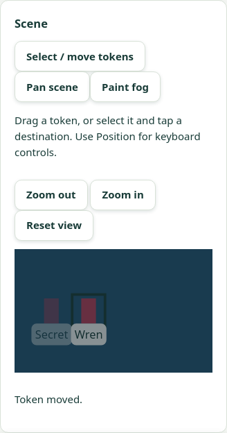
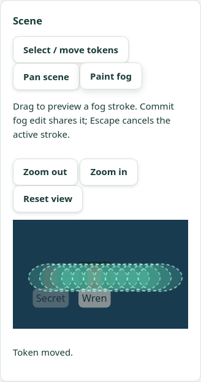
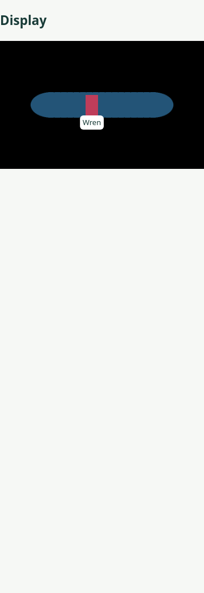
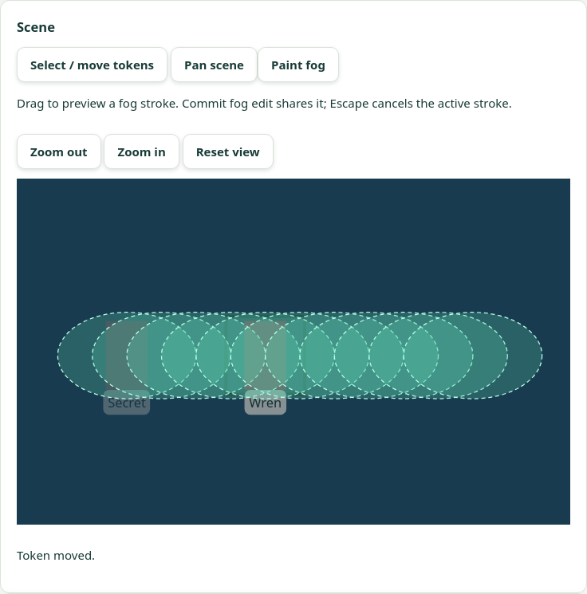
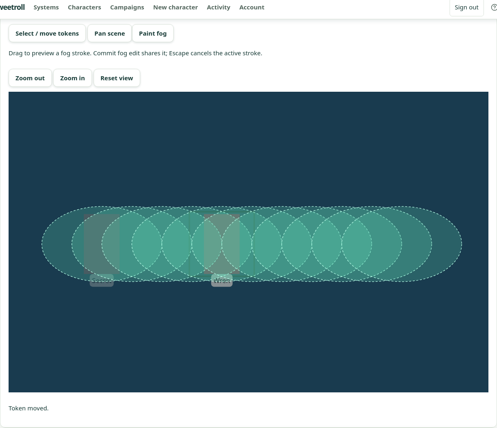

# V4 combined visual scene controls — 6 November 2026

PR: https://github.com/Kajonn/sweetroll/pull/38, stacked on #36 (which includes #37).

Status: combined automated feature acceptance passed locally and on the isolated
hosted preview. This closes the I7b/G8 visual-controls completion gate. Physical
Android/iPad/PWA input, real provider login, human visual approval and actual
table/remote G9 playtests remain open. Emulated touch is not physical-device evidence.
Final-head CI is tracked in PR #38; this evidence alone does not assert a public release.

## Scope and ordered protocol

`web/tests/e2e/sceneVisualControls.spec.ts` exercises the whole sequence in one
campaign and scene, rather than treating separate V1/V2/V3 tests as aggregate proof.
Only authentication and disposable campaign provisioning use fixture HTTP calls;
background/scene creation, artwork upload/selection, token placement/movement,
fog, pairing, background replacement and revocation use the real GUI.
Independent HTTP reads verify saved state; competing writes and deliberately lost
real successful responses exercise revision/idempotency recovery.

| Order | Checks | Result |
| --- | --- | --- |
| 1 | Upload background and create/open a scene through GUI. | PASS |
| 2 | Upload token art, explicitly select existing art, tap-place visible Wren and hidden Secret; pair a separate credential-only display. Both token-image endpoints deny bytes while fogged. | PASS |
| 3 | At 360/768/1280px, zoom/pan without writes, tap-move, mouse-drag and native CDP touch-drag; previews send no requests and each release saves once. Reopen preserves exact token records. | PASS |
| 4 | Cancel a token move with Escape; use keyboard position/Move. A real competing write requires explicit fresh-revision retry. A dropped real successful response retries the identical move/key without another revision. | PASS |
| 5 | At every width, mouse and native emulated touch paint under zoom/pan. Bounded normalized drafts match the radius; Undo and cancellation leave committed state and display pixels untouched. | PASS |
| 6 | Repaint and commit Reveal; verify decoded source-colored display pixels and exact decoded RGBA token art, saved center and proportional size in both GM/display views at every width. Hidden token and its image remain unavailable. Commit Conceal; visible token disappears and its image endpoint denies bytes. | PASS |
| 7 | Real fog conflict retains draft until explicit fresh-key retry. Dropped successful fog response retries the identical command/key without another revision. Keyboard dab/commit and reopen preserve fog. Display requests no GM APIs and cannot read original background bytes. | PASS |
| 8 | GM offline transition clears the draft; reconnect preserves revision and both token records. Replacement with a GUI-uploaded background resets fog, tokens and local draft; display pixels are concealed. | PASS |
| 9 | Read real projection successfully, revoke through GUI, observe display blanking and 404 from the same credential/path. Archive test campaign and independently read back archived status. | PASS |

A permitted token is intentionally unavailable before Reveal; its display geometry
is checked immediately after Reveal permits its bytes. The display never obtains
the original background beneath a client-only fog overlay. Revealed information
already seen or captured cannot be retracted.

## Development and local verification

V1–V3 supply the test-first application implementations. V4 adds acceptance tests
and evidence only: no application, schema, migration, dependency or offline queue
changes were required. Initial combined-test attempts exposed two harness mistakes:
trying to reselect already-selected artwork (correctly disabled), and using a
move destination still inside the token hit target. The runner now explicitly
switches to label-only before selecting existing art, and clicks a distinct
scene destination. Neither failure is recorded as an application defect. A later hosted run exposed a
pixel-probe race: display polling correctly revoked an obsolete blob URL while
the test tried to fetch it again. The probe now samples a decoded loaded image
atomically through canvas, retaining the same exact RGBA assertions and bounded
frame-readiness wait. It never substitutes original pixels or hides mismatches;
no application changes or automatic test retries were added.

| Check | Result |
| --- | --- |
| Full frontend component suite | 1,277 passed, 131 files |
| Backend/frontend typechecks | Passed |
| Generated contracts check | Passed |
| Production frontend build | Passed |
| PostgreSQL campaign scenes/token media | 30 passed |
| PostgreSQL background replacement/image foundation | 9 passed |
| Local combined real-HTTP browser journey | 1 passed in 40.6s, zero retries |
| Axe on GM scene route; horizontal overflow at all widths | Passed |
| Diff/whitespace check | Passed |

Local execution uses disposable PostgreSQL 18.6, the established clean-image
scanner fixture and real HTTP/Vite processes. Workspace Unix-socket and network
interface enumeration restrictions require `node --import tsx` instead of the
`tsx` CLI and an explicit loopback bind. Repository runtime/CI launch paths were
not changed to accommodate the workspace.

## Hosted identity and results

Target: https://sweetroll-d2-preview.up.railway.app
Project `sweetroll-d2-acceptance`, environment `preview`, service `sweetroll-d2`.
Production and main-linked acceptance sources were unchanged.

| Field | Verified value |
| --- | --- |
| Deployed commit | `3a35a5f0fb381aa1b1986c857f2b6ba41cf004b5` |
| Deployment | `f33cf328-a585-49d2-bf17-f2c3237f80c4`, terminal SUCCESS |
| Source | `Kajonn/sweetroll`, `test/scene-visual-controls`, pinned to tested commit |
| Readiness | `/health/ready` → `{"status":"ok"}` |
| Served JS | `/assets/index-YVS7s7JI.js`, SHA-256 `9c903a9a37aedea0883b040246b8b13d556abf599902ffa49a9aedd22db8e571` |
| Served CSS | `/assets/index-DF3Bkxz_.css`, SHA-256 `8d74655dc84143613f866c3f90298313a931a8f380e4c4b7927744f389421a55` |
| Build identity | Served JS/CSS match tested local production build byte for byte |
| Final hosted journey | PASS in 89.1s total; 1 expected, 0 unexpected/skipped/flaky, zero retries |
| Cleanup | Display revoked; campaign archived with independent readback |

The application runtime is unchanged from V3's accepted `637a60f`; the intervening
commits contain tests, CI setup and documentation. The final run tests the newly
pinned V4 deployment itself. Later acceptance-document/screenshot commits do not
change tested runtime or browser-test bytes.

Reproduce against the isolated hosted target:

```sh
SCENE_VISUAL_HOSTED=1 \
G9_ACCEPTANCE_URL=https://sweetroll-d2-preview.up.railway.app \
node web/node_modules/@playwright/test/cli.js test \
  --config web/playwright.scene-visual.config.ts
```

Without the hosted flag, the same config uses the normal local E2E services and
PostgreSQL environment. Normal journey CI includes the new spec automatically;
its test does not mock scene/media/display routes.

[Machine evidence](scene-visual-controls-2026-11-06.json) includes the final
Playwright totals, build identity, cleanup readback and screenshot hashes.







This feature completion does not close the broader G9 release checklist or select
new feature work. Merge #36 before #38; real-login planning remains separate in #32.
